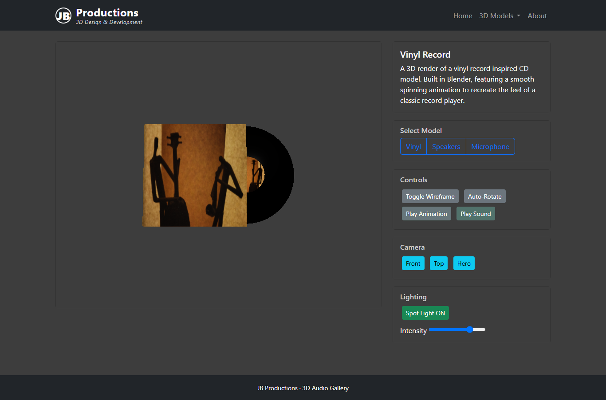

# JB Productions · 3D Audio Gallery

An interactive gallery of three original Blender models: a vinyl record, bookshelf
speakers and a microphone with stand. It combines browser-based 3D rendering
with a small PHP/SQLite catalogue API.



## Features

- Three animated GLB models, with editable Blender source files.
- Orbit/zoom controls, wireframe, auto-rotation and three camera presets.
- Spotlight controls and bloom post-processing.
- Per-model audio demonstrations with coordinated animation playback.
- Responsive carousel with arrow buttons, keyboard navigation and touch gestures.
- Product metadata served through PHP/SQLite, with a static JSON fallback.

Audio playback starts an existing animation; it does not analyse beats or drive
geometry from the audio waveform.

## Run locally

Requirements: PHP 8.2 or newer with **PDO SQLite** enabled, a modern WebGL-capable
browser with ES module/import-map support, and an internet connection for CDN libraries.
There is no npm build step, Composer dependency or database password.

From the repository root:

```sh
php -m
php -S 127.0.0.1:8000
```

Check that `PDO` and `pdo_sqlite` appear in the module list, then open
[localhost:8000](http://127.0.0.1:8000). Windows users with XAMPP can use
`C:\xampp\php\php.exe` in place of `php` if it is not on PATH. Apache is not
required for PHP's local development server.

The first catalogue API request creates `db/products.db` and seeds its three rows
from `application/model/data.json`. The process needs write permission to `db/`
or permission to create it. The generated database is ignored by Git and is not
included in the upload package.

After changing the catalogue JSON, stop PHP and remove **only** the generated
`db/products.db` (and its sidecars, if any) to rebuild the demo catalogue on the
next request. There is deliberately no HTTP reset route. Existing rows are not
overwritten on each page visit.

Do not double-click `index.html`, use `file://`, or rely on VS Code Live Server
for the full application. JSON fallback helps with an API failure; it does not
provide PHP support or make the full project suitable for GitHub Pages.

## Structure and request flow

```text
index.php                      HTML entry point and allowlisted API router
index.html                     Home, model viewer and About containers
js/main.js                     Three.js scene, loading, controls and audio
js/getJsonData.js               Catalogue fetch, fallback and description updates
js/ui.js                       Section navigation and lazy-loaded About content
js/carousel.js                 Home carousel controls
application/controller/        Catalogue API controller
application/model/             PDO model and seed JSON
application/view/              About partial
models/                        Three browser-ready GLBs
blender-source/                Three editable .blend projects
images/, textures/, audio/     Model previews, textures and original demo samples
tests/                         Small standalone regression checks
docs/                          Project refresher, media credits and cleanup log
```

The browser requests product metadata from `index.php`; the controller reads it
through the PDO model. Three.js separately loads the selected GLB and its embedded
textures/animations. The viewer retains the original three-ID model/audio maps;
the catalogue is not a dynamic asset-management system.

| Endpoint | Behaviour |
| --- | --- |
| `GET index.php?action=apiGetProducts` | All catalogue products |
| `GET index.php?action=apiGetProduct&id=1` | One product; IDs 1, 2 and 3 are supplied |

Missing/invalid IDs return 400, an absent product or unknown action returns 404,
and non-GET API requests return 405. Unexpected API errors return a generic 500
response, with details logged server-side. `apiSetup` is no longer exposed.

## Stack

HTML/CSS and vanilla JavaScript; Bootstrap **5.3.2**; jQuery **3.7.1**; Font Awesome
**6.4.0**; Three.js **0.160.0** with GLTFLoader, OrbitControls, AnimationMixer,
EffectComposer and UnrealBloomPass; PHP/PDO; SQLite; Blender **5.1** source files.
Library versions are preserved from the project rather than upgraded wholesale.

## Checks

With Node.js installed:

```sh
node tests/viewer-regression.cjs
```

With Python 3 and PHP installed (runs against its own temporary project copy):

```sh
python tests/check_api.py
# Or specify PHP when it is not on PATH:
python tests/check_api.py --php C:\xampp\php\php.exe
```

Manually exercise all three models, camera/light controls, animations, audio,
rapid model switching, Home/About navigation and a narrow viewport. Automated
logic checks are not a substitute for visual review on your target browsers.


No blanket open-source licence has been selected for the author's code/models.
Third-party libraries and recordings retain their own terms.
